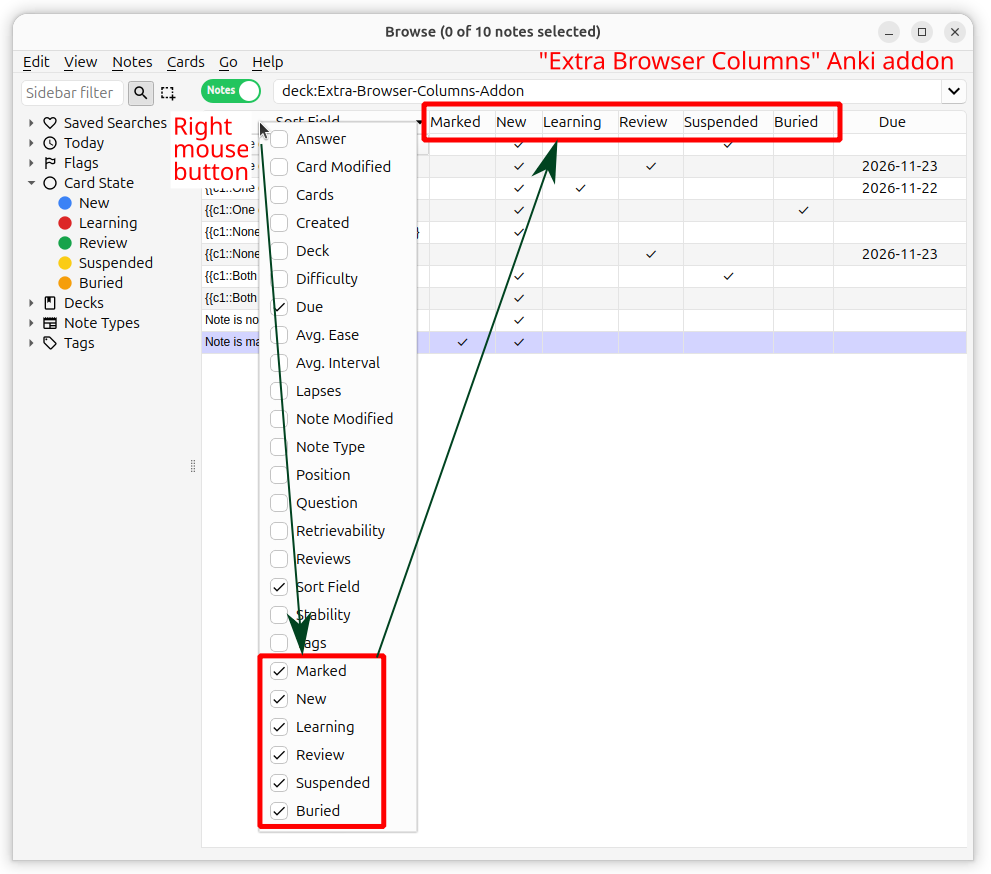

**"Extra Browser Columns" addon adds 6 sortable columns to the Browser:
"Marked", "New", "Learning", "Review", "Suspended" and "Buried".**

## Columns

A column shows `✓` if the card (in Cards mode) or any card of the note (in Notes mode):

- **Marked**: the note has the `marked` tag
- **New**: is new
- **Learning**: is in learning or relearning
- **Review**: is in review or relearning
- **Suspended**: is suspended
- **Buried**: is buried (manually or by siblings)

The New, Learning and Review columns match the "Card State" filters of the Browser sidebar
(`is:new`, `is:learn`, `is:review`), so a relearning card is both Learning and Review.

## Usage

- Enable a column: right-click the Browser table header and choose the column.
- Click a column header to sort: flagged items are listed first (click again to reverse);
  within each group items are ordered by the Sort Field.
- Double-click the right border of a column header to shrink the column to its `✓`.
- Hover a column header to see the column name and description (handy when the column is narrow).

Supported Anki version: 26.09.4+

## Contacts

If you have a **question**, met a **bug** or have a **feature request**, create an issue at
[GitHub bug tracker](https://github.com/Aleks-Ya/extra-browser-columns-anki-addon/issues).

## Links

- [GitHub project](https://github.com/Aleks-Ya/extra-browser-columns-anki-addon)
- [Bug tracker](https://github.com/Aleks-Ya/extra-browser-columns-anki-addon/issues)
- [Changelog](https://github.com/Aleks-Ya/extra-browser-columns-anki-addon/blob/main/CHANGELOG.md)

